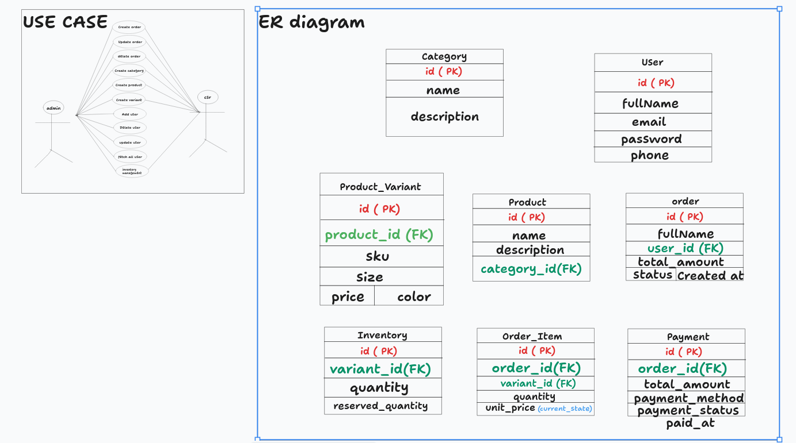

# OMS — Step-by-Step Plan



**OMS** stands for **Order Management System**. It manages the product catalog, tracks stock in storage, and handles customer orders.

All endpoints live under `/api/v1`.

## Progress

| Phase | Module                     | Status          |
|-------|----------------------------|-----------------|
| 1     | Basic authentication       | Partly done     |
| 2     | Category, Product, Variant | Almost done     |
| 3     | Auth guard and roles       | **Next task**   |
| 4     | Inventory                  | Not started     |
| 5     | Orders                     | Not started     |

---

## Phase 1: Basic Authentication

Register and log in users. Passwords are hashed with BCrypt.

- [x] `POST /auth/register` — create a new user
- [x] `POST /auth/login` — check credentials (token and role are still hardcoded, fixed in Phase 3)
- [ ] `GET /auth/me` — return the logged-in user's profile (needs Phase 3)
- [ ] `POST /auth/logout` — optional; with JWT the client just drops the token

## Phase 2: Catalog (Category, Product, Variant)

Products come before inventory because stock is counted per product variant.

**Category**

- [x] `GET /category` — list categories
- [x] `GET /category/{id}` — get one category
- [x] `POST /category` — create a category
- [x] `PUT /category/{id}` — update a category
- [x] `DELETE /category/{id}` — delete a category

**Product**

- [x] `GET /product` — paginated list of products
- [x] `GET /product/{id}` — get one product
- [x] `POST /product` — create a product
- [x] `PUT /product/{productId}/variants/{variantId}/price` — update a variant's price
- [x] `DELETE /product/{id}` — delete a product

**Variant**

- [x] `GET /variant` — paginated list of variants
- [x] `GET /variant/{id}` — get one variant
- [x] `POST /variant` — create a variant for a product
- [ ] `PUT /variant/{id}` — update SKU, size, color, or price
- [ ] `DELETE /variant/{id}` — delete a variant

**Product shape**

```json
{
  "name": "T-Shirt",
  "description": "Cotton tee",
  "categoryId": 1,
  "variants": [
    { "sku": "TS-RED-M", "size": "M", "color": "Red", "price": 19.99 },
    { "sku": "TS-BLU-L", "size": "L", "color": "Blue", "price": 21.99 }
  ]
}
```

---

## Phase 3: Auth Guard and Roles — NEXT TASK

**Goal:** every request must come from a logged-in user, and only admins can change the catalog.

This comes before orders because an order belongs to a user. The order code needs to know who is calling.

**Access rules**

| Action                                         | Guest | USER | ADMIN |
|------------------------------------------------|-------|------|-------|
| Register, log in                               | Yes   | Yes  | Yes   |
| View products, categories, variants            | No    | Yes  | Yes   |
| Create, update, delete products, categories, variants | No | No | Yes |

**Steps**

- [ ] **1. Role on the user.** Add a `Role` enum (`USER`, `ADMIN`) and a `role` column on `User`, defaulting to `USER`. Registration always sets `USER`; never read the role from the request body.
- [ ] **2. JWT service.** Add the `jjwt` dependencies. Create `JwtService` with `generate(user)` and `parse(token)`. Keep `jwt.secret` in `application.yaml`.
- [ ] **3. Real login response.** In `AuthService.login()`, return a generated token and the user's actual role instead of `"verified"` and `"admin"`.
- [ ] **4. Auth filter.** Create `JwtAuthFilter` (`OncePerRequestFilter`). It reads `Authorization: Bearer <token>` and sets the user and role in the security context.
- [ ] **5. Security rules.** In `SecurityConfig`: stateless sessions, `/auth/**` open, `GET` on the catalog for any logged-in user, all other catalog methods for `ADMIN` only, everything else authenticated. Register the filter.
- [ ] **6. `GET /auth/me`.** Return the profile of the user in the token.
- [ ] **7. First admin.** Promote one user to `ADMIN` directly in the database.

**Done when**

- [ ] `GET /product` without a token returns `401`
- [ ] `GET /product` with a USER token returns `200`
- [ ] `POST /product` with a USER token returns `403`
- [ ] `POST /product` with an ADMIN token returns `201`

## Phase 4: Inventory

Track how many units of each variant are in storage. Orders depend on this.

- [ ] `Inventory` entity: one row per variant with a quantity
- [ ] `GET /inventory/{variantId}` — check stock for a variant (any logged-in user)
- [ ] `PUT /inventory/{variantId}` — set or adjust stock (ADMIN)
- [ ] Reject any change that would make stock negative

## Phase 5: Orders

- [ ] `Order` and `OrderItem` entities; each item stores the variant, quantity, and the price at the time of ordering
- [ ] `POST /orders` — place an order for the logged-in user; check and reduce stock in one transaction
- [ ] `GET /orders` — a user sees their own orders, an admin sees all
- [ ] `GET /orders/{id}` — get one order (owner or ADMIN)
- [ ] `PUT /orders/{id}/status` — change the order status (ADMIN)
- [ ] Cancelling an order puts the stock back
